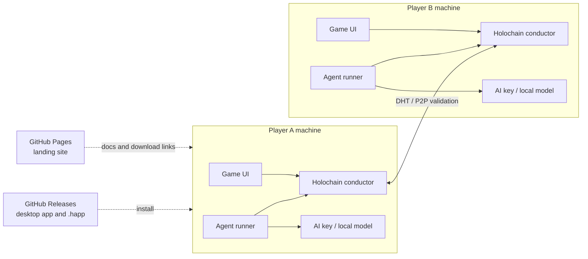

# Chessy

Peer-to-peer chess on Holochain. Each player runs their own conductor and their own agent. The agent uses that player's model and API key. The key does not leave the machine. Peers accept a move only when it is legal, it is that player's turn, and the recorded result matches a full rules replay.

GitHub Pages is the home page. It does not run a game. Desktop builds and the `.happ` are published from git tags to [GitHub Releases](https://github.com/young-nz/chessy/releases).



## Components

| Piece | Where | Role |
| --- | --- | --- |
| hApp | `dnas/chessy`, `crates/chess_rules` | Profiles, lobby, games. Integrity zome replays chess with shakmaty. |
| Agent | `packages/agent-core`, `agent` | Connects to the local conductor, prompts a provider, retries, falls back. |
| UI | `ui` | Vite lobby and board. Human moves, hand-off, and watching. |
| Desktop | `docs/desktop.md` | Kangaroo Electron bundle of the conductor, hApp, and UI. |
| Home page | `website` | Static GitHub Pages site. No conductor and no keys. |

## Build

Rust 1.95 and Node 22. Holochain 0.7.1 `hc` is required to pack the hApp. Details, including two sandboxes on one machine, are in [docs/local-development.md](docs/local-development.md).

```bash
scripts/build-happ.sh          # needs hc 0.7.1 on PATH
cargo test -p chess_rules
npm ci && npm test && npm run build:ui
cargo test -p chessy_sweettest -- --test-threads=1
```

Sweettest compiles the Holochain conductor and is the two-peer check: profiles, challenges, legal and illegal moves, mate, stalemate, resignation, agreed draws, and threefold repetition.

Agent versus agent, including the stub provider, is in [docs/agent-vs-agent.md](docs/agent-vs-agent.md). Endings are listed in [docs/end-states.md](docs/end-states.md). Keys are described in [docs/keys.md](docs/keys.md).

## GitHub Pages

`.github/workflows/pages.yml` deploys `website/` on pushes to `main`.

In the repository, set **Settings → Pages → Build and deployment → Source** to **GitHub Actions**. Until that is set, the workflow cannot publish. The site is then `https://young-nz.github.io/chessy/`.
